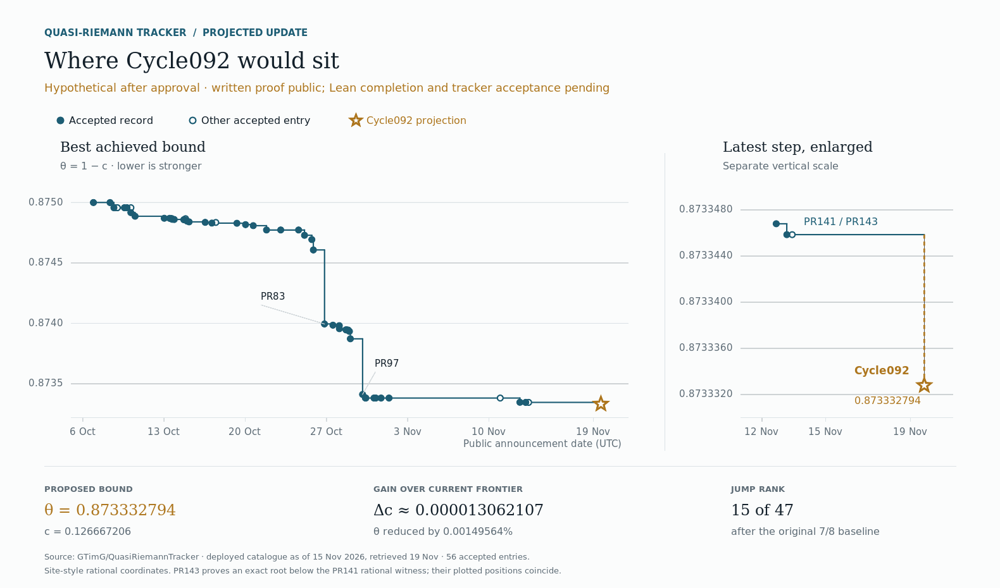

**Hailey Collet** · [HaileyCollet@gmail.com](mailto:HaileyCollet@gmail.com)

<nav class="paper-downloads" aria-label="Cycle092 paper and proof downloads">
  <a class="paper-download paper-download--primary" href="Cycle092-proof.pdf">Read the paperPDF · complete public proof</a>
  <a class="paper-download" href="Cycle092-proof.tex">TeX sourceStandalone file</a>
  <a class="paper-download" href="cycle092-lean-source-50a933d719e4.zip">Lean sourceZIP · exact commit</a>
</nav>

*The ordinary QRH half-plane: a compact working proof* gives **c = 63333603/500000000 = 0.126667206**, with the strict zero-free boundary **Re(s) > 436666397/500000000 = 0.873332794**.

The theorem covers every ordinary complex Dirichlet character at each fixed positive presented modulus, including imprimitive presentations and all heights. It excludes the principal pole at s = 1. It makes no assertion on the boundary line or of uniform constants in growing moduli.

The [written submission, PR #45](https://github.com/rohanarun/quasi-rh-hillclimb/pull/45), retains the complete public proof and its finite evidence. This edition adds a dated account of the later local Lean formalization. The [complete manuscript source bundle](cycle092-manuscript-source.zip) includes the original public Markdown, certificates, replay program, TeX inputs and notices.

## Formalization and verification

The unconditional final root compiled locally in **Lean 4.34.1**. A separate process checked its exact all-Dirichlet signature and audited both exported declarations. Their axioms are **propext, Classical.choice and Quot.sound**.

A later staged local check passed for **2,325 Candidate source modules**, using **4,405 approved dependency objects**. The run retained 245 successful first-phase modules after a controlled scheduler resume and compiled the remaining 2,080 modules. Its canonical signature audit passed and its axiom audit reports only **propext, Classical.choice and Quot.sound**. [Download the staged-source receipt](cycle092-staged-lean-50a933d719e4.json).

The dependency objects were reused under the recorded approval checks. Canonical independent kernel replay, GTimG’s protected exact-commit verification and tracker admission are separate checks; this page does not claim those outcomes. The chart remains projected until tracker approval.

The formal Lean submission is [GTimG PR #144](https://github.com/GTimG/QuasiRiemannTracker/pull/144). Its protected checks and tracker admission remain separate from these local receipts.

[Read the local verification record](verification/) and [machine-readable receipt](cycle092-local-lean-50a933d719e4.json). The Lean download contains the committed submission source at `50a933d719e4adf2775fabe9774a53000dfea522`; [SHA-256 checksums](cycle092-lean-source-50a933d719e4.sha256) and the [file manifest](cycle092-lean-source-50a933d719e4.manifest.json) identify the download. Its declared upstream dependencies are separate.

## Projected tracker comparison

<figure class="cycle092-chart">
  
  <figcaption>Projection only, using the public tracker snapshot retrieved 19 November 2026. The amber open star is Cycle092; it is not an accepted tracker entry. Open the image for the full-size SVG. The chart’s status line reflects that dated snapshot; the later local check is reported above.</figcaption>
</figure>

This is a reconstruction from the tracker’s public data, with public-announcement dates. [Chart sources and scope](chart/) explain the frozen comparison; consult the [live tracker](https://gtimg.github.io/QuasiRiemannTracker/) for its accepted frontier.

## Authorship and sources

I directed this research and am the sole human author of this contribution. Research, drafting and code development were substantially AI-assisted. That assistance does not constitute independent mathematical or kernel verification.

The proof retains the OpenAI QRH framework and the contributions credited in the manuscript, including ArviFoxy, Sil, Joseph Bebel, SovereignSteak, Joe Richey and Jacob Sussman, alongside my earlier work. The [source notice](NOTICE.md) and downloaded proof sources retain the detailed attribution and inherited licences. New publication material is under [Apache-2.0](LICENSE).

The [QRH-Catalogue](https://github.com/HaileyStorm/QRH-Catalogue) collects source-backed QRH mathematics and reusable formal components. This continues my [earlier QRH research](/research/cycle61-qrh-boundary/).
